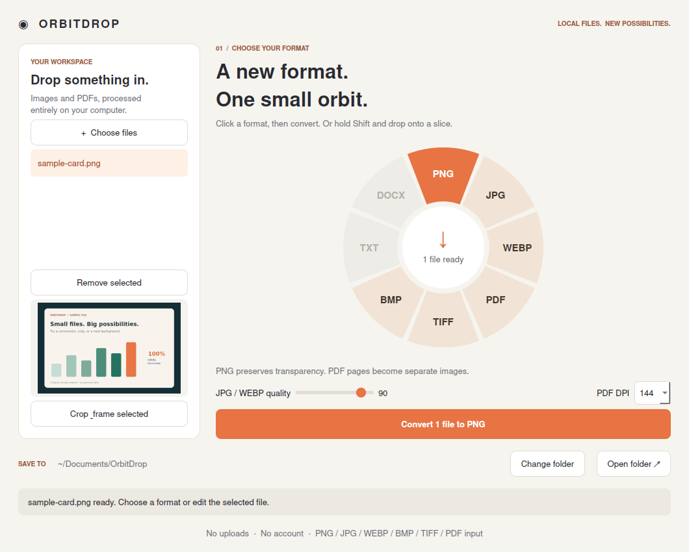
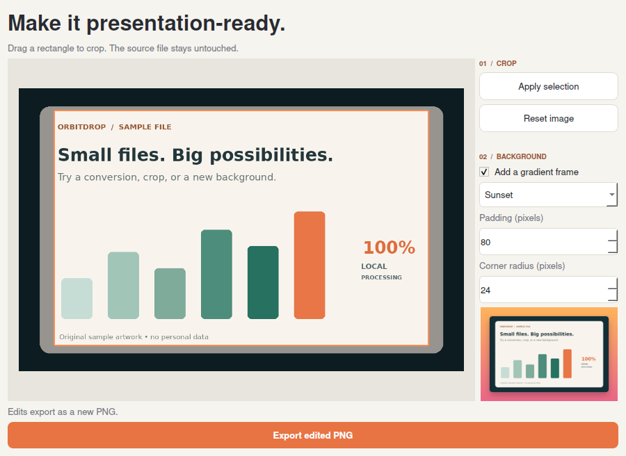

# OrbitDrop

**A local desktop file converter with a radial format menu.**

Drop images or PDFs into the app, pick an output format, and export without uploading your files. Hold **Shift** while dropping onto a format slice to convert the dropped files immediately. Crop an image or the first page of a PDF and add a gradient frame for a presentation-ready PNG.



## Run it

Use **Python 3.12**. Open a terminal in this project folder.

**macOS**

```bash
python3 -m venv .venv
.venv/bin/python -m pip install -r requirements.txt
.venv/bin/python run.py
```

**Windows PowerShell**

```powershell
py -3.12 -m venv .venv
.\.venv\Scripts\python.exe -m pip install -r requirements.txt
.\.venv\Scripts\python.exe run.py
```

Install Python from [python.org](https://www.python.org/downloads/) if it is not installed. The first dependency installation needs internet access. The app itself processes files locally and has no network, account, or telemetry functionality.

For a detailed walkthrough, see [START_HERE.md](START_HERE.md).

## What it does

- Converts individual files or a queue of files, with format compatibility checks.
- Renders every PDF page as a separately numbered image at 72, 144, 200, or 300 DPI.
- Extracts selectable PDF text into TXT or a simple DOCX document.
- Preserves transparency for PNG, WEBP, and TIFF; flattens it onto white for JPG, BMP, and PDF.
- Provides JPG/WEBP quality controls and image/PDF previews.
- Crops with a mouse selection and adds gradient backgrounds, padding, rounded corners, and shadows.
- Uses background workers to keep the interface responsive during loading and export.
- Creates unique output filenames instead of overwriting existing files.

| Input | Output |
| --- | --- |
| PNG, JPG/JPEG, WEBP, BMP, TIF/TIFF | PNG, JPG, WEBP, BMP, TIFF, PDF |
| PDF | PNG, JPG, WEBP, BMP, TIFF, TXT, DOCX |
| Image or first PDF page in editor | Edited PNG |

## How to use it

1. Select **Choose files**, or drag files into the app.
2. Click an enabled format on the circle.
3. Choose an output folder and adjust quality or PDF DPI if needed.
4. Click **Convert** and then **Open folder**.

**Shortcut:** drag files over the circle, hold **Shift**, and release them over a format slice. Only those dropped files are converted; files already in the queue are not included in that shortcut operation.

**Editing:** select a file in the list, choose **Crop & frame selected**, drag a rectangle, and click **Apply selection**. Set a background style and export a new PNG. Click **Reset image** to return to the original. A PDF is edited as a rasterized first page.



Try the included `samples/sample-card.png` and `samples/sample-document.pdf`. The PDF contains two pages of selectable text so you can test both page rendering and text extraction.

## Scope and limitations

This is an independent implementation inspired by a drag-and-Shift file-conversion demo: [reference reel](https://www.instagram.com/reel/DeoFIQkBaHz/). It uses original source code and UI assets; the reel is not included in the repository.

- Drag-and-Shift works **inside the OrbitDrop window**, not as a system-wide Finder/Explorer overlay.
- HEIC, AVIF, audio/video conversion, OCR, annotation, and redaction are not implemented.
- DOCX export extracts text; it does not reconstruct the PDF's tables, images, or page layout. DOCX input is not supported.
- Animated images and multi-frame TIFFs use only their first frame.
- A PDF becomes one image per page; images become separate single-page PDFs, not one merged document.
- Conversion does not preserve original metadata or color profiles. It is not a color-managed prepress workflow.
- Quality changes may reduce file size, but smaller output is not guaranteed.
- Inputs are limited to 100 MB; conversions are limited to 100 PDF pages and 40 million pixels per image. Framed outputs must also fit the pixel limit.
- Password-protected PDFs are not supported. Failed multi-page conversions roll back files created for that input; successful inputs in the same batch remain saved.
- Files already being processed must finish before the app can close. There is no cancel button in this version.

## Structure

```text
orbitdrop/
  core.py         Conversion, text extraction, cropping, framing, safe output paths
  app.py          Qt window, drag/drop, radial menu, crop editor, worker threads
  __main__.py     Module entry point
run.py            Simple launcher
tests/            Conversion and GUI integration tests
samples/          Original example image and two-page PDF
docs/             Screenshots and engineering notes
```

The conversion engine is independent of Qt. The UI delegates document operations to one worker at a time, and updates widgets on the main thread. A lock also serializes PDFium calls because PDFium is not thread-safe. Output filenames are reserved with exclusive creation, and partially written files are removed on failure.

## Tests

```bash
python -m unittest discover -s tests -v
```

Run that command with the virtual environment's Python (`.venv/bin/python` on Mac or `.\.venv\Scripts\python.exe` on Windows). The interface tests set Qt's `offscreen` platform automatically.

**Verified for this release:** 17 automated tests passed on Linux with Python 3.12, including real image/PDF exports and simulated Qt drag/drop, format selection, crop, and export interactions. The app and editor were also rendered and visually inspected. Native macOS/Windows behavior still needs to be checked on those systems. The included GitHub Actions workflow is configured for Linux, macOS, and Windows; no remote CI results are claimed here.

See [engineering notes](docs/ENGINEERING.md) for design decisions, tests, tradeoffs, and extension ideas.

## License and dependencies

The original project code is MIT licensed. Dependency licenses apply separately. PySide6/Qt is available under LGPL/GPL/commercial terms; review the applicable terms before distributing a bundled executable. This repository distributes source code and installs dependencies through pip.

Built with [PySide6](https://doc.qt.io/qtforpython-6/), [Pillow](https://pillow.readthedocs.io/), [pypdfium2](https://pypdfium2.readthedocs.io/), [pypdf](https://pypdf.readthedocs.io/), and [python-docx](https://python-docx.readthedocs.io/).
